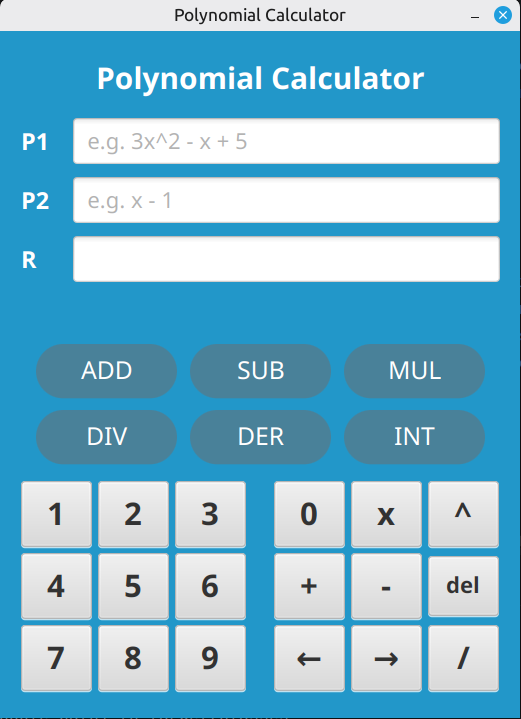

# Polynomial Calculator

A desktop calculator for polynomials with rational coefficients, built with Java and JavaFX.
Originally developed as a university lab assignment, later refactored and extended.



## Features

- **Arithmetic:** addition, subtraction, multiplication
- **Division:** polynomial long division, showing both quotient and remainder
- **Calculus:** derivative and indefinite integral (operating on P1)
- **Exact results:** coefficients are stored as fractions, so `∫x dx` gives `1/2x^2`, not a rounded decimal
- **Input validation:** invalid input is reported with a clear message instead of being silently ignored

## Input format

Polynomials use the variable `x`. Spaces are optional.

| Input | Meaning |
|---|---|
| `3x^2 - x + 5` | 3x² − x + 5 |
| `x^3 - 1` | x³ − 1 |
| `1/2x^2 + 3` | (1/2)·x² + 3 |

Coefficients can be integers or fractions, and exponents must be non-negative integers.
A fractional coefficient applies to the whole term, so `1/2x` means (1/2)·x.

## Getting started

**Requirements:** JDK 21 or newer. Maven doesn't need to be installed, since the project includes the Maven Wrapper.

```bash
git clone https://github.com/tavim26/polynomial-calculator.git
cd polynomial-calculator
./mvnw javafx:run
```

On Windows, use `mvnw.cmd javafx:run`.

To run the unit tests:

```bash
./mvnw test
```

## Project structure

```
src/main/java/io/github/tavim26/polynomial/
├── model/   Rational, Monomial, Polynomial, PolynomialParser
├── logic/   Operations, DivisionResult
└── gui/     CalculatorApp, CalculatorController
```

The project follows a layered design:

- **`model`** holds immutable value types. `Rational` is always kept in lowest terms. `Polynomial` stores terms sorted by degree and never stores zero coefficients.
- **`logic`** holds the algorithms. Each operation takes polynomials and returns a new one, without modifying its inputs.
- **`gui`** holds the JavaFX interface. The layout is in FXML and the styling in CSS.

## Tech stack

Java 21 · JavaFX 21 · Maven · JUnit 5

## License

This project is licensed under the [MIT License](LICENSE).